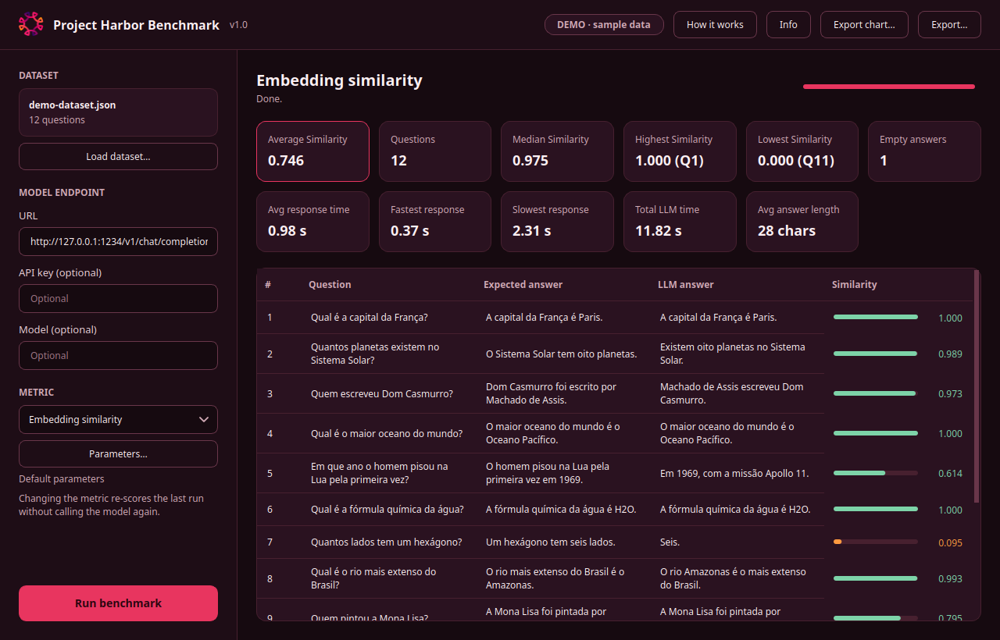
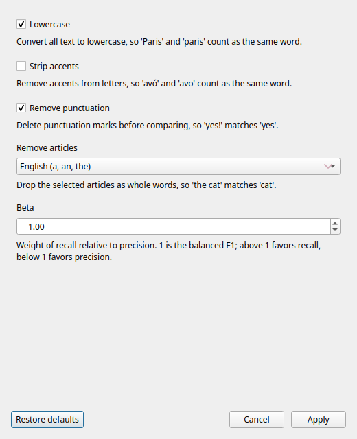
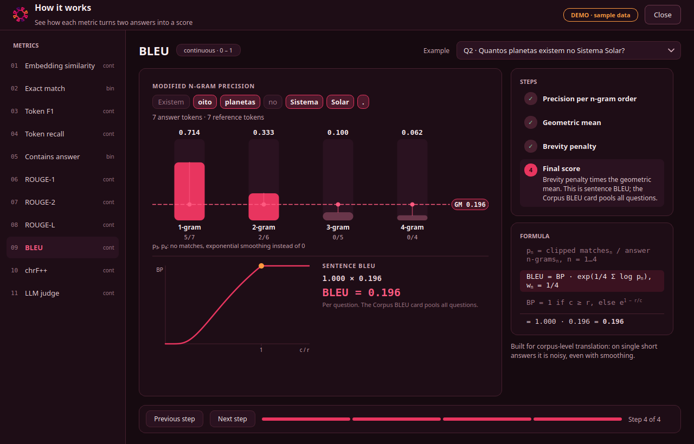

<div align="center">


### A desktop benchmark for LLMs, scored against a fixed question set.

**Load a dataset. Point it at your model. Get comparable scores, and see exactly how each one is computed.**

[](https://www.python.org/)
[](https://doc.qt.io/qtforpython-6/)
[](https://github.com/qdrant/fastembed)
[](#metrics)
[](https://pyinstaller.org/)
[](#quick-start)
[](LICENSE)

[Features](#features) · [Quick start](#quick-start) · [Usage](#usage) · [RAG](#evaluating-rag-systems) · [Metrics](#metrics) · [License](#license)

</div>

<br />

<div align="center">

</div>

<br />

Project Harbor Benchmark lets a team evaluate different LLM approaches on the same dataset in the same way. For each question, the app calls your model through an OpenAI-compatible endpoint (for example `http://127.0.0.1:1234/v1/chat/completions`), or through the native Anthropic or Gemini API, compares the answer with the expected one, and scores it from 0 to 1 with any of 21 metrics. For RAG systems, the answers can also come from a RAG endpoint or from an imported run file together with the contexts that were retrieved, so retrieval and grounding are measured separately from the final answer. Scoring is offline: the embedding model ships inside the app and every metric runs on your machine, except the four that ask a judge model. Only calls to a cloud provider need a connection and an API key.

## Features

- **21 metrics in three groups, all configurable.** Answer quality: Embedding similarity, Exact match, Token F1, Token recall, Contains answer, ROUGE-1, ROUGE-2, ROUGE-L, BLEU, chrF++, LLM judge and Answer relevancy. Retrieval: Hit rate@k, Context precision@k, Context recall@k, MRR, nDCG@k and Context relevance. Grounding: K-Precision, Context coverage and Faithfulness. Each one has its own parameters, and switching metric or parameters after a run re-scores the stored answers without calling the LLM again.
- **RAG evaluation.** Answers come from a model endpoint, a RAG endpoint that also returns the retrieved contexts, or an imported run file. Metrics that need contexts or relevance labels are disabled, with the reason, until the run has them.
- **Info window.** Formulas, parameters with defaults and ranges, and the reference papers for every metric.
- **"How it works" explorer (demo mode).** One animated scene per metric that shows, step by step, how an answer (and, for RAG metrics, its ranked contexts) becomes a score.
- **Offline scoring.** The embedding model is bundled and the dataset is a plain JSON file you choose. Only the LLM judge and cloud providers need a connection.
- **Overview chart.** One PNG with every metric at once: a bar for the mean and a dot for the median.
- **Run statistics.** Median, highest and lowest score, response times, empty answers and average answer length.
- **JSON and CSV export** of every run, including the parameters used, the retrieved contexts and the offline retrieval and grounding scores next to the selected metric.
- **Demo mode** that computes real scores with the real metrics on 12 sample questions, with no LLM and no dataset needed.
- **Native desktop app** for Linux (`.AppImage`) and Windows, built with Qt.

## Quick start

Download the latest build from the releases page (or from the `build` workflow artifacts), or run it from source.

### Demo mode

The fastest way to see the app. It opens the same window with 12 sample questions and a simulated run, makes no network calls, and needs no embedding model download:

```sh
python3 -m venv .venv
.venv/bin/pip install -r requirements-dev.txt
.venv/bin/python main_demo.py
```

The scores are real: every metric runs its real code on the sample answers. The embedding similarity and Answer relevancy use precomputed vectors from [`demo/demo_embeddings.json`](demo/demo_embeddings.json); the LLM judge, Faithfulness, Context relevance and the questions behind Answer relevancy use fixed sample judge outputs. Switch **Answers from** to **RAG endpoint** or **Imported run** to get sample retrieved contexts ([`demo/demo_rag_data.py`](demo/demo_rag_data.py)) and unlock the retrieval and grounding metrics. The sample answers themselves are fictional and must not be mistaken for results of a real model. Export and Export chart write real files. The data lives in [`demo/demo_data.py`](demo/demo_data.py).

### Real mode

```sh
.venv/bin/python scripts/prefetch_model.py
.venv/bin/python main.py
```

`prefetch_model.py` downloads the embedding model (about 240 MB) into `models/`, which is what lets the app run offline afterwards. Then you need a dataset (see [Dataset format](#dataset-format)) and an LLM endpoint (see [Supported providers](#supported-providers)).

### Building the AppImages

```sh
APPIMAGE_EXTRACT_AND_RUN=1 APPIMAGETOOL=<path to appimagetool> sh scripts/build_appimage.sh normal
APPIMAGE_EXTRACT_AND_RUN=1 APPIMAGETOOL=<path to appimagetool> sh scripts/build_appimage.sh demo
```

`normal` builds the real app and `demo` builds the demo app.

### Tests

```sh
.venv/bin/python -m pytest
```

In a headless environment, set `QT_QPA_PLATFORM=offscreen` first.

## Usage

1. Open the app. A splash screen shows while the embedding model loads.
2. Click **Load dataset…** and pick your JSON file. Everything else stays disabled until a valid dataset is loaded.
3. Choose a **Metric** (default: Embedding similarity) and, if you want, adjust it with **Parameters…**.
4. Choose where the answers come from in **Answers from**. For **Model endpoint**, enter the LLM URL; **API key** and **Model** are optional for local servers, the URL works without `http://`, and the provider is picked from the URL. For **RAG endpoint** or **Imported run**, see [Evaluating RAG systems](#evaluating-rag-systems).
5. Click **Run benchmark** and follow the progress. The table and the metrics panel fill in when it finishes.
6. Use **Export…** to save the result as JSON or CSV, and **Export chart…** to save an overview PNG. The chart is per category (Answer quality, Retrieval or Grounding in contexts), because each one measures something different; the dialog disables the categories the run cannot support.

Loading a new dataset clears the previous result. Changing the metric or its parameters after a run recalculates the score column immediately from the answers already collected.

| Area | What it does |
|---|---|
| **Dataset** | **Load dataset…** opens a JSON file; the name and question count appear below. |
| **Metric** | Drop-down with the 21 metrics in three groups. Metrics whose data is missing are disabled, with the reason in the tooltip. Changing it re-scores the last run without calling the model. |
| **Answers from** | Model endpoint, RAG endpoint (URL, API key, answer and contexts fields) or Imported run (**Load run…**). Changing it clears the last result. |
| **Model endpoint / Judge model** | URL, optional API key and optional model name. The provider is chosen from the URL. With a RAG endpoint or an imported run it becomes the optional judge model used by the judge metrics. |
| **Parameters…** | Opens a dialog with the selected metric's parameters. See [Metric parameters](#metric-parameters). |
| **Run benchmark / Stop run** | Starts the run, or cancels it (closing the window mid-run is safe). |
| **Metrics panel** | Average, median, highest and lowest score, response times, empty answers and average answer length. Binary metrics show correct and incorrect counts instead. |
| **Score table** | One row per question: expected answer, LLM answer and a score bar. Runs with contexts add a **Contexts** column with the count; hover it to see ids, retrieval scores and text. |
| **How it works** | Demo only. Opens the animated metric explorer. |
| **Info** | Formulas, parameters and references for every metric. |
| **Export…** / **Export chart…** | JSON or CSV of the run, and one overview PNG per metric category. |

### Dataset format

The dataset is a JSON list of questions. See [`examples/questions.example.json`](examples/questions.example.json).

```json
[
  {
    "id": "1",
    "question": "What is the capital of Brazil?",
    "expected_answer": "The capital of Brazil is Brasília."
  }
]
```

`id` is optional; when missing, the position in the list is used. The dataset is never bundled with the app, so your team can share and version it separately.

Two optional fields label which contexts should be retrieved. Retrieval metrics need one of them on every question:

```json
{
  "id": "1",
  "question": "Who painted the Mona Lisa?",
  "expected_answer": "Leonardo da Vinci.",
  "relevant_context_ids": ["art#3"],
  "relevant_passages": ["Leonardo da Vinci painted the Mona Lisa between 1503 and 1519."]
}
```

`relevant_context_ids` are matched against the ids your RAG returns. `relevant_passages` are matched by text, which keeps working when two systems chunk the documents differently: a context counts as relevant when it contains at least a set share (default 50%) of the passage's words.

### Metric parameters

<div align="center">

</div>

<br />

**Parameters…** opens a dialog for the selected metric only, with one control per parameter, a description under each, and **Restore defaults**. Pressing **Apply** re-scores the last run immediately, without calling the model. The defaults reproduce the classic definition of each metric, and the sidebar says when the defaults are in use. Values live in memory for the session and reset when the app closes. The JSON export includes them under `method_parameters`, so a result always says how it was scored.

For the LLM judge, **Set temperature** is off by default, which means the provider's own default is used (some models reject custom temperatures). The **Temperature** value only applies when it is on.
### The "How it works" explorer

<div align="center">

</div>

<br />

In demo mode, **How it works** opens a window with one animated scene per metric. Pick a metric on the left and an example on the top right; the scene plays through numbered steps (for BLEU: precision per n-gram order, geometric mean, brevity penalty, final score) while the matching line of the formula is highlighted and the numbers are filled in. The scene follows the current **Parameters…** values, so changing the BLEU smoothing or the F1 beta changes what you see. Playback can be paused, restarted and stepped, at 0.5×, 1× or 2× speed. Set `HARBOR_REDUCE_MOTION=1` before starting the app to turn off all interface animations.

## Evaluating RAG systems

RAG metrics need the contexts the system retrieved for each question. There are two ways to give them to the app.

**RAG endpoint.** Choose **Answers from → RAG endpoint** and enter its URL. The app sends `POST {"question": "…"}` and reads the answer and the contexts from the JSON reply:

```json
{"answer": "Leonardo da Vinci.", "contexts": [{"id": "art#3", "text": "Leonardo da Vinci painted…", "score": 0.82}]}
```

**Answer field** and **Contexts field** accept dotted paths for nested replies, such as `data.output.text`. A context can be a plain string or an object with `text` (also `content`, `page_content` or `passage`), an optional `id` (also `doc_id`, `chunk_id`…) and an optional `score`. A URL containing `/chat/completions` is called like an OpenAI-compatible model instead, and the contexts field is looked up in the body, in `choices[0].message` and in `choices[0]`.

**Imported run.** Run your own pipeline and save one answer per question, then choose **Answers from → Imported run** and **Load run…**. JSON lists, JSON Lines (`.jsonl`) and results exported by this app are accepted:

```json
{"id": "1", "answer": "Leonardo da Vinci.", "contexts": ["Leonardo da Vinci painted…"], "response_seconds": 1.2}
```

Answers are matched to the dataset by `id`; extra answers are ignored and missing ones are reported. Importing is a good way to compare pipelines that do not expose HTTP, or to re-score old runs without calling anything.

With either source, the **Model endpoint** section becomes **Judge model**. It is optional and only used by the judge metrics (LLM judge, Answer relevancy, Context relevance and Faithfulness). The sidebar shows how many judge calls a metric makes before you run it.

## Supported providers

The provider is chosen from the **URL**; there is no extra field.

| Provider | URL | API key | Model |
|----------|-----|---------|-------|
| OpenAI-compatible (OpenAI, LM Studio, Ollama, vLLM, OpenRouter, Groq…) | The full `…/chat/completions` URL | Optional (`Authorization: Bearer`) | Optional |
| Anthropic | `https://api.anthropic.com` (the path `/v1/messages` is added when missing) | Required (`x-api-key`) | Required, for example `claude-sonnet-4-5` |
| Google Gemini | `https://generativelanguage.googleapis.com` (the path `/v1beta/models/<model>:generateContent` is built from **Model**), or the full `…:generateContent` URL | Required (`x-goog-api-key`) | Required when the URL has no path |

Any URL containing `/chat/completions` is treated as OpenAI-compatible, including the compatibility endpoints of Anthropic and Google. Anthropic answers are capped at 4096 output tokens.

## Metrics

Every metric returns a score from 0 to 1 per question. Answer-quality metrics compare the LLM answer with `expected_answer`; retrieval metrics look at the ranked contexts; grounding metrics compare the answer (or the expected answer) with the contexts. The **Parameters** column lists what you can configure in **Parameters…**, with defaults in bold.

| Metric | Per-question score | Parameters (defaults in bold) |
|---|---|---|
| Embedding similarity | Similarity between the two embeddings, scaled to 0 to 1. Captures meaning and tolerates paraphrase; multilingual model bundled. | Similarity function (**cosine**, dot product, angular, euclidean, manhattan); Negative values (**clip**, rescale); Normalize vectors (**on**) |
| Exact match | 0 or 1 after normalization | Lowercase (**on**); Strip accents (off); Remove punctuation (**on**); Remove articles (**English**, Portuguese, both, none) |
| Token F1 | F-measure over normalized tokens, counting repeats | The four normalization options above; Beta (**1.0**, range 0.1 to 10) |
| Token recall | Share of expected tokens found in the answer. Does not penalize extra words, so it suits verbose models. | The four normalization options above |
| Contains answer | 0 or 1: the normalized expected answer appears in the answer | The four normalization options above; Match mode (**whole words**, substring) |
| ROUGE-1, ROUGE-2 | Unigram or bigram overlap | Score type (**F-measure**, precision, recall); Beta (**1.0**); Lowercase (**on**) |
| ROUGE-L | Longest common subsequence | Same as ROUGE-1 |
| BLEU | Sentence BLEU (`sacrebleu`); the panel also shows corpus BLEU | Maximum n-gram order (**4**, 1 to 6); Smoothing method (**exp**, floor, add-k, none); Floor value (**0.1**); Add-k value (**1**); Tokenizer (**13a**, intl, char, none); Ignore letter case (off); Effective order (**on**) |
| chrF++ | Character n-gram F-score (`sacrebleu`). Tolerates inflection and accents better than word metrics. | Character n-gram order (**6**, 1 to 10); Word n-gram order (**2**, 0 to 3); Recall weight beta (**2**, 1 to 6); Ignore letter case (off); Include whitespace (off); Epsilon smoothing (off) |
| LLM judge | Rating given by a model, divided by the scale maximum | Rating scale maximum (**10**, 2 to 100); Prompt template; Samples per answer (**1**, 1 to 10, averaged); Set temperature (**off**); Temperature (**0.0**, 0 to 2, only when set) |
| Answer relevancy | The judge writes questions from the answer; mean embedding similarity to the original question. Measures focus, not correctness; needs no contexts. | Generated questions (**3**, 1 to 10); the embedding similarity options; Prompt template; temperature |
| Hit rate@k | 0 or 1: a relevant context is among the first k | Cutoff k (**5**, 1 to 100); Match relevant contexts by (**automatic**, IDs only, text only); Text match threshold (**0.5**) |
| Context precision@k | Relevant contexts among the first k, divided by k | Same as Hit rate@k |
| Context recall@k | Labelled items found in the first k, divided by the number of labelled items | Same as Hit rate@k |
| MRR | 1 / rank of the first relevant context (the run average is the mean reciprocal rank) | Same as Hit rate@k, with k = **10** |
| nDCG@k | Discounted gain of newly found relevant items over the ideal ranking | Same as Hit rate@k; Gain (**binary**, graded by text coverage) |
| Context relevance | Judge rates each context for the question; mean rating divided by the maximum. Needs no labels. | Rating scale maximum (**1**, yes or no); Contexts considered (**5**); Prompt template; temperature |
| K-Precision | Share of answer tokens found in the contexts | The four normalization options; Contexts considered (**0** = all) |
| Context coverage | Share of expected-answer tokens found in the contexts | Same as K-Precision |
| Faithfulness | The judge splits the answer into statements and checks each against the contexts; supported / all | Maximum statements (**20**); Contexts considered (**0** = all); two prompt templates; temperature |

The judge metrics (LLM judge, Answer relevancy, Context relevance and Faithfulness) call the model endpoint, which is the evaluated model itself in **Model endpoint** mode and the optional judge model otherwise. They need a connection and are left out of the overview chart unless the run used them. Retrieval metrics need contexts and relevance labels, and grounding metrics need contexts; the overview chart and the export include them whenever the run has that data. Binary metrics (Exact match, Contains answer, Hit rate@k) show correct and incorrect counts instead of median, highest and lowest score.

Things to keep in mind when reading the scores:

- Exact match and F1 are designed for short answers. Chat models tend to answer in full sentences, which lowers these scores even when the answer is right. Either write the expected answers in the same style or configure the LLM to answer briefly.
- The ROUGE tokenizer accepts accented letters, unlike the original `rouge-score`, which only considers `a-z` and `0-9`. Results on non-English text can therefore differ from it.
- Sentence BLEU is unstable on very short answers. Corpus BLEU is more reliable for comparing approaches.
- Applying a benchmark's formula to your own dataset does not reproduce that benchmark's published score; it only reuses the calculation.
- Context precision@k always divides by k, so a system that returns fewer than k contexts scores lower. Compare systems with the same k.
- Faithfulness flags correct facts that are not in the contexts, by design: it measures grounding, not truth. Read it next to an answer-quality metric.

### References

| Metric | Papers |
|---|---|
| Embedding similarity | Reimers & Gurevych 2019, [Sentence-BERT](https://aclanthology.org/D19-1410/), EMNLP-IJCNLP; Steck, Ekanadham & Kallus 2024, [Is Cosine-Similarity of Embeddings Really About Similarity?](https://arxiv.org/abs/2403.05440), WWW '24 Companion |
| Exact match | Chen, Stanovsky, Singh & Gardner 2019, [Evaluating Question Answering Evaluation](https://aclanthology.org/D19-5817/), MRQA@EMNLP; Bulian et al. 2022, [Tomayto, Tomahto. Beyond Token-level Answer Equivalence for Question Answering Evaluation](https://aclanthology.org/2022.emnlp-main.20/), EMNLP |
| Token F1 | Christen, Hand & Kirielle 2024, [A Review of the F-Measure: Its History, Properties, Criticism, and Alternatives](https://doi.org/10.1145/3606367), ACM Computing Surveys 56(3); Chen et al. 2019 (above) |
| Token recall | Adlakha et al. 2024, [Evaluating Correctness and Faithfulness of Instruction-Following Models for Question Answering](https://aclanthology.org/2024.tacl-1.38/), TACL 12 |
| Contains answer | Adlakha et al. 2024 (section 4.1, "Recall (Strict)"); Kamalloo, Dziri, Clarke & Rafiei 2023, [Evaluating Open-Domain Question Answering in the Era of Large Language Models](https://aclanthology.org/2023.acl-long.307/), ACL |
| ROUGE-1 / ROUGE-2 | Lin 2004, [ROUGE: A Package for Automatic Evaluation of Summaries](https://aclanthology.org/W04-1013/), Text Summarization Branches Out; Grusky 2023, [Rogue Scores](https://aclanthology.org/2023.acl-long.107/), ACL |
| ROUGE-L | Lin & Och 2004, [Automatic Evaluation of Machine Translation Quality Using Longest Common Subsequence and Skip-Bigram Statistics](https://aclanthology.org/P04-1077/), ACL; Lin 2004 (above) |
| BLEU | Papineni et al. 2002, [BLEU: a Method for Automatic Evaluation of Machine Translation](https://aclanthology.org/P02-1040/), ACL; Chen & Cherry 2014, [A Systematic Comparison of Smoothing Techniques for Sentence-Level BLEU](https://aclanthology.org/W14-3346/), WMT; Post 2018, [A Call for Clarity in Reporting BLEU Scores](https://aclanthology.org/W18-6319/), WMT; Callison-Burch, Osborne & Koehn 2006, [Re-evaluating the Role of Bleu in Machine Translation Research](https://aclanthology.org/E06-1032/), EACL |
| chrF++ | Popović 2015, [chrF: character n-gram F-score for automatic MT evaluation](https://aclanthology.org/W15-3049/), WMT; Popović 2016, [chrF deconstructed: beta parameters and n-gram weights](https://aclanthology.org/W16-2341/), WMT; Popović 2017, [chrF++: words helping character n-grams](https://aclanthology.org/W17-4770/), WMT |
| LLM judge | Zheng et al. 2023, [Judging LLM-as-a-Judge with MT-Bench and Chatbot Arena](https://arxiv.org/abs/2306.05685), NeurIPS Datasets and Benchmarks; Gu et al. 2024, [A Survey on LLM-as-a-Judge](https://arxiv.org/abs/2411.15594) |
| Answer relevancy, Context relevance, Faithfulness | Es, James, Espinosa Anke & Schockaert 2024, [RAGAs: Automated Evaluation of Retrieval Augmented Generation](https://aclanthology.org/2024.eacl-demo.16/), EACL System Demonstrations; Saad-Falcon, Khattab, Potts & Zaharia 2024, [ARES: An Automated Evaluation Framework for Retrieval-Augmented Generation Systems](https://aclanthology.org/2024.naacl-long.20/), NAACL |
| Hit rate, Context precision@k, Context recall@k | Manning, Raghavan & Schütze 2008, [Introduction to Information Retrieval](https://nlp.stanford.edu/IR-book/), ch. 8, Cambridge University Press; Yu et al. 2024, [Evaluation of Retrieval-Augmented Generation: A Survey](https://arxiv.org/abs/2405.07437) |
| MRR | Voorhees 1999, [The TREC-8 Question Answering Track Report](https://www.nist.gov/publications/trec-8-question-answering-track-report), TREC-8 |
| nDCG@k | Järvelin & Kekäläinen 2002, [Cumulated gain-based evaluation of IR techniques](https://doi.org/10.1145/582415.582418), ACM TOIS 20(4) |
| K-Precision, Context coverage | Adlakha et al. 2024 (above), K-Precision; Yu et al. 2024 (above) |

## License

Released under the [MIT License](LICENSE).
